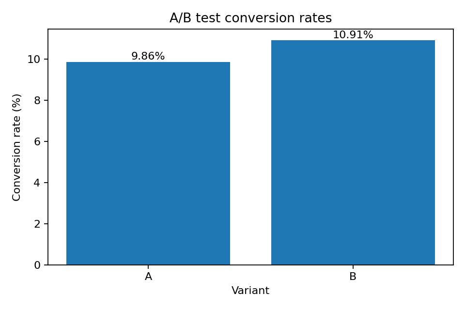

# Advanced A/B Testing — Mathematical Statistics & Experimentation

**Research-oriented, reproducible portfolio project** combining hypothesis testing, randomization inference, bootstrap uncertainty, Bayesian conjugate modeling, power calculations, Monte Carlo validation, SQL and automated tests.

> **Synthetic educational dataset only.** The 20,000 users are simulated, with generating probabilities 10% and 11%. No real-company or production experiment claims.

## Research question
Does a treatment increase conversion relative to control? Estimate the absolute treatment effect and quantify uncertainty. Compare frequentist, randomization-based and Bayesian answers and assess whether the experiment is adequately powered.

## Quick start (Windows PowerShell or terminal)
```bash
python -m pip install -r requirements.txt
python -m src.analyze
python -m src.advanced
python -m src.load_sqlite
python -m pytest -q
```

## Results and recruiter walkthrough

### Conversion Rate Comparison

The following chart compares conversion rates between the control and treatment groups.


- [`results/research_report.md`](results/research_report.md) — **actual computed findings**, design implications and limitations.
- [`results/advanced_results.json`](results/advanced_results.json) — machine-readable reproducible metrics.
- [`results/conversion_rates.png`](results/conversion_rates.png) — conversion chart.
- [`docs/mathematical_methods.md`](docs/mathematical_methods.md) — derivations, assumptions and statistical distinctions.
- [`src/advanced.py`](src/advanced.py) — from-scratch permutation, bootstrap, Beta-Binomial posterior, power and simulation functions.
- [`src/analyze.py`](src/analyze.py) — classical z-test and baseline interval.
- [`sql/analysis.sql`](sql/analysis.sql) — conversion analysis with SQLite.
- [`tests/`](tests/) — unit tests and reproducibility checks.

## Key methodological choices
The permutation test conditions on the observed binary outcomes under exchangeability. Bootstrap resamples *within* arms. Bayesian posterior statements depend on explicit Beta(1,1) priors. Monte Carlo experiments check operating characteristics of the fixed-horizon z-test. Power calculations use an asymptotic normal approximation.

## Engineering and ethics
Seeded random generators make stochastic computations reproducible. Validate data before inference. Avoid uploading personal customer data, credentials or environment files. The project does not include an API because experimentation inference is not necessarily an online prediction service.

## Next improvements
Add pre-registered guardrails, variance reduction (CUPED) with pre-treatment covariates, sequential-valid inference, and sensitivity analyses on real *authorized* experiment data.
